# 小纸 InkPaper 架构解析与架构图

> 分析对象：`InkPaper` 仓库（Flutter 包名 `inkpaper`，应用名「小纸」/「InkPaper-墨鸣笔记」，v1.1.13+10113）
> 分析方法：对仓库做**只读静态分析**（源码阅读 + 依赖关系提取 + 构建/清单核对），不修改任何业务代码
> 分析时间：2026-10 · 分析范围：`lib/` 162 个 Dart 文件、`android/` 4 个 Kotlin 文件、平台工程、CI 工作流

---

## 0. 结论速览（先看这一页）

| 问题 | 结论 |
|---|---|
| 这是"安卓 app 源码"吗？ | **不完全是。** 这是一个 **Flutter 跨平台工程**：业务代码几乎全部在 `lib/*.dart`（102,042 行 / 162 文件），Android 只是 6 个平台外壳之一（`android/ ios/ macos/ windows/ linux/ web/`）。Android 侧只有 4 个 Kotlin 文件、1,353 行。 |
| 架构风格 | **分层架构 + 单一状态中心**：表现层 → 状态层（1 个 `ChangeNotifier`）→ 服务层（54 个服务）→ 数据层（1 个 SQLite 库）→ 平台层/外部服务。 |
| 数据策略 | **本地优先（local-first）**：所有写入先落 SQLite，云同步是可选的二级链路。 |
| 同步后端 | 3 条并行链路：**Memos API**（官方 / 自托管，主力）、**WebDAV**（备份恢复）、**Notion**（双向同步）。 |
| 规模 | `lib/` 102,042 行 / 162 文件；测试 6,277 行 / 39 文件（约为 lib 代码量的 6%）；Android 原生 1,353 行；平台外壳 6 套；CI 7 + 9 个 job。 |
| 最大结构性风险 | ① `AppProvider` 单类 **4,613 行 / 131 个方法**的上帝对象，且包住整个 `MaterialApp.router` 全量重建；② `notes.db` **明文无加密**；③ 同步**无删除墓碑、无冲突记录、无离线队列**；④ 约 **3,000+ 行死代码**（服务 10 个文件 + Widget 7 个文件）。 |
| 构建状态（2026-10-16 实测） | ✅ `flutter build apk --debug` **成功**，产出 176 MB 的 `app-debug.apk`（详见 [§9.3](#93-android-构建兼容性与实测编译记录)）。曾导致硬失败的 Gradle 8.12 / AGP 8.9.1 / KGP 2.1.0 已在工作区升级为 **8.14.3 / 8.11.1 / 2.2.20（改动尚未提交）**，现仅剩 3 条"版本将不再支持"告警。 |

---

## 1. 项目身份与仓库边界

| 项 | 值 | 出处 |
|---|---|---|
| 产品名 | 小纸（InkPaper），应用内标题 `InkPaper-墨鸣笔记` | `README.md:1`、`lib/main.dart:685` |
| Flutter 包名 | `inkpaper` | `pubspec.yaml:1` |
| Android applicationId / namespace | `com.didichou.inkpaper` | `android/app/build.gradle:33,52` |
| 版本 | `1.1.13+10113`（单一真源） | `pubspec.yaml:6` |
| Dart SDK 约束 | `>=3.0.0 <4.0.0` | `pubspec.yaml:9` |
| 本机 Flutter SDK | `Z:\flutter` = **3.47.7 / Dart 3.13.5**，stable | `.dart_tool/package_config.json` |
| 上游关系 | 本项目是 [InkPaper](https://github.com/yyyyymmmmm/InkPaper) 的延续与重命名版本 | `README.md:5` |
| 当前仓库 | `github.com/liudengxing/InkPaper` | `README.md:5` |
| 开源许可 | MIT | `LICENSE` |

### ⚠️ 仓库里混入了非工程源码

工作目录中存在以下**与工程无关的素材**，它们已被 `.gitignore:122-127` 排除，**不属于本项目架构**：

| 路径 | 性质 |
|---|---|
| `Ego一构_v1.2.3.apk`（34 MB） | 第三方 APK 安装包（`*.apk` 被忽略） |
| `Ego_v1.2.3_decompiled/`、`反编译/*.jadx` | 上述 APK 的反编译产物（jadx） |
| `LOCAL_DEV_SETUP.md` | 本机环境笔记 |

> 因此：**做架构分析时只应看 `lib/ + android/ + ios/ + macos/ + windows/ + linux/ + test/ + tool/ + .github/`。** 反编译目录是另一个 App（"一构"）的产物，与本项目无代码关系。

---

## 2. 架构总览图

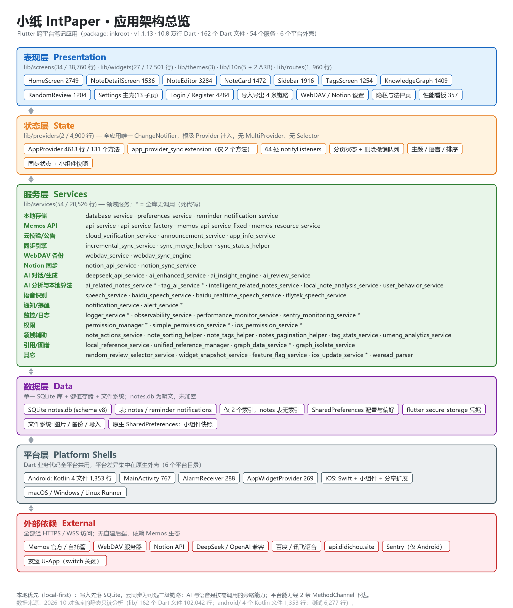

同一张图的 Mermaid 版本（可编辑、可版本化）：

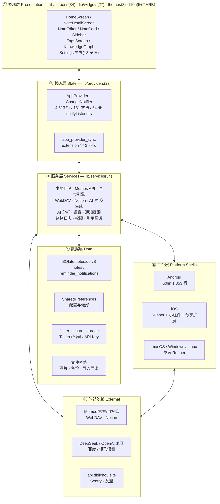

### 各层职责与关键文件

| 层 | 目录 | 文件数 / 行数 | 职责 | 关键文件 |
|---|---|---|---|---|
| ① 表现层 | `lib/screens` `lib/widgets` `lib/themes` `lib/l10n` `lib/routes` | 34 / 38,760 27 / 17,501 3 / 1,060 5+2 / 7,814 1 / 960 | 页面、复用组件、主题、文案、路由 | `home_screen.dart`(2,749)、`note_editor.dart`(3,284) |
| ② 状态层 | `lib/providers` | 2 / 4,900 | 全局状态与业务编排 | `app_provider.dart`(4,613) |
| ③ 服务层 | `lib/services` | 54 / 20,526 | 领域能力，隔离 IO 与第三方 | `database_service.dart`(781)、`memos_api_service_fixed.dart`(1,046) |
| ④ 数据层 | `lib/models` + 平台存储 | 13 / 2,521 | 实体模型与持久化 | `note_model.dart`(503) |
| ⑤ 平台层 | `android/ ios/ macos/ windows/ linux/ web/` | Android 4 / 1,353 | 原生能力与平台外壳 | `MainActivity.kt`(767) |
| ⑥ 外部依赖 | 网络 / 第三方 SDK | — | 同步后端、AI、语音、监控 | — |
| 工具层 | `lib/utils` | 19 / 6,522 | 无状态工具函数 | `share_utils.dart`(2,434) |

### 目录地图

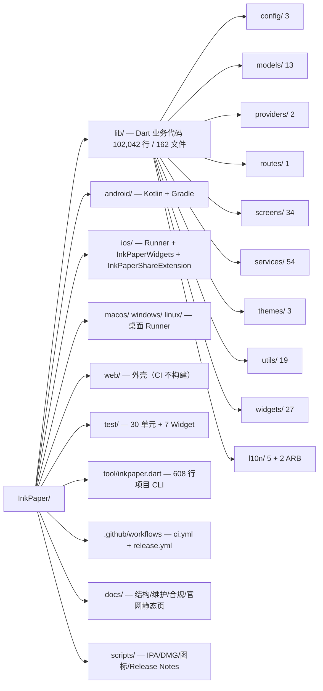

---

## 3. 运行时启动与装配

`lib/main.dart`（837 行）的启动序列**严格有序**，且分成"外层（runApp 前）"和"内层（首帧后）"两段：

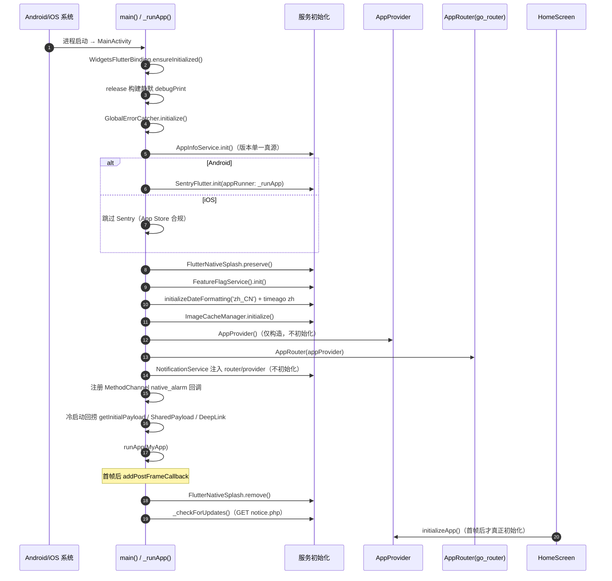

**关键设计点**

1. **配置是编译期注入，不是运行时 `.env`。** `flutter_dotenv` 虽在 `pubspec.yaml:121` 声明，但 `lib/` 内**零引用**；所有配置走 `String.fromEnvironment` + `--dart-define`（`.env.example` 明确说明了这一点）。可注入项：`ENVIRONMENT`、`CLOUD_VERIFY_APP_KEY`、`SENTRY_DSN`、`UMENG_*`、`BAIDU_SPEECH_*`、`FEATURE_FLAG_URL`、`CANARY_PERCENTAGE`、`ASSET_CDN_BASE_URL`、`INKPAPER_SCREENSHOT_MODE`。

2. **权限按需申请**（模仿微信/支付宝）：启动时**不申请任何权限**，麦克风/通知/相机/相册都在用户触发对应功能时才请求（`main.dart:169-174`）。

3. **通知服务故意延迟初始化**：`NotificationService` 只在用户首次设置提醒时才初始化（`main.dart:197-199`）。

4. **`AppProvider.initializeApp()` 在 HomeScreen 首帧后才执行**（`home_screen.dart:82, 423-455`）。这是**脆弱点**：若用户通过深链直接进入 `/note/:id`、`/privacy-policy`、`/onboarding`，HomeScreen 不参与构建，provider 处于 `isInitialized == false`、`_notes == []` 状态。

---

## 4. 状态管理层

### 4.1 AppProvider：单一状态中心

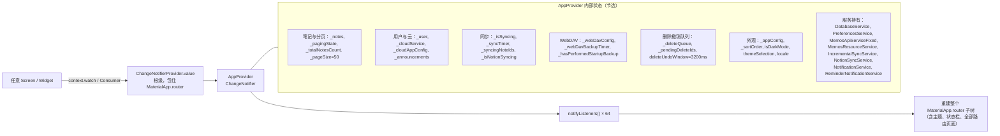

| 指标 | 值 |
|---|---|
| 单类规模 | **4,613 行**（`app_provider.dart` 单文件），含 part 文件共 4,900 行 |
| 方法级成员 | 131 个 |
| `notifyListeners()` 调用点 | 64 处 |
| 拆分了什么 | 仅 2 个方法（`fetchNotesFromServer`、`syncWithServer`）移到 `extension AppProviderSyncPart`（part 文件 287 行，占 ~6%） |
| 粒度策略 | **无** Selector、无 `MultiProvider`、无细粒度 Provider；根级 `Consumer` 包住整个 `MaterialApp.router` |

**已有反模式**：`app_provider.dart:404-413` 出现 `notifyListeners()` 后紧跟 `Future.microtask(() { if (mounted) notifyListeners(); })`，注释写"双重通知确保 UI 更新"，属于用重复通知掩盖更新时序问题的权宜之计。

### 4.2 路由（go_router 10.2）

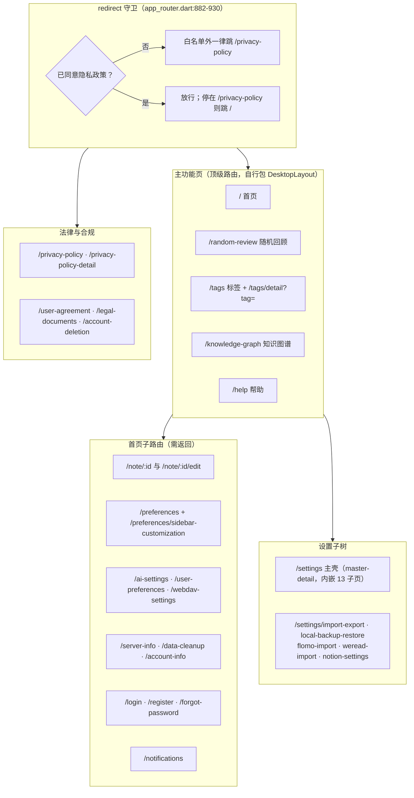

路由要点：

- **无登录/鉴权守卫**。唯一的守卫是隐私政策 gate（`app_router.dart:888-904`），且每次导航都同步读一次 SharedPreferences；没有 `refreshListenable`。
- **无 shell route**，没有 `StatefulShellRoute`；桌面/移动差异由每个页面自己包 `DesktopLayout`（仅 6 个页面这么做）。
- **过渡动画**：iOS 走 `CupertinoPage`（支持侧滑返回）；Android 走自研 350ms 滑入 + 旧页视差 -12% + 0.98 缩放；侧边栏切换用 400ms 交叉溶解。
- **重复注册**：`/notifications` 注册两次（`app_router.dart:505` 与 `:872`）、`/account-deletion` 两次（`:305` 与 `:392`）——go_router 同级重复 path 属配置错误，后一个 name 实际不可达。
- **死路由**：`/onboarding`、`/welcome` 可路由但引导逻辑被注释（`app_router.dart:912-922`），改由 HomeScreen 用 `isFirstLaunch` 兜底。

---

## 5. 服务层拓扑

54 个服务按能力分 15 组。下图是**从 import 语句提取的真实依赖边**（不是推测）：

```mermaid
flowchart TB
    AP["AppProvider<br/>（37 个文件引用）"]

    subgraph CORE["核心依赖枢纽"]
        direction LR
        DB["DatabaseService<br/>被 11 个文件引用"]
        PREF["PreferencesService<br/>被 9 个文件引用"]
    end

    subgraph MEMOS["Memos API 链路"]
        direction LR
        MEM["MemosApiServiceFixed<br/>被 5 个文件引用"]
        RES["MemosResourceService"]
        FACT["ApiServiceFactory"]
        INCR["IncrementalSyncService"]
        MERGE["sync_merge_helper"]
        STAT["sync_status_helper"]
    end

    subgraph AI["AI 链路"]
        direction LR
        DS["DeepSeekApiService<br/>被 4 个文件引用"]
        ENH["AIEnhancedService"]
        INS["AIInsightEngine"]
        REV["AiReviewService"]
        LOC["LocalNoteAnalysisService"]
    end

    subgraph WDAV["WebDAV 链路"]
        direction LR
        WDS["WebDavService"]
        WDE["WebDavSyncEngine"]
    end

    subgraph NOTION["Notion 链路"]
        direction LR
        NAPI["NotionApiService"]
        NSYNC["NotionSyncService"]
    end

    subgraph REF["引用关系"]
        direction LR
        LRS["LocalReferenceService"]
        URM["UnifiedReferenceManager"]
    end

    subgraph NOTI["通知链路"]
        direction LR
        NOTI1["NotificationService"]
        REM["ReminderNotificationService"]
    end

    subgraph SPEECH["语音链路"]
        direction LR
        SP["SpeechService"]
        BAIDU["BaiduSpeechService + Realtime"]
        IFY["IflytekSpeechService"]
    end

    AP --> DB
    AP --> PREF
    AP --> FACT
    AP --> MEM
    AP --> RES
    AP --> INCR
    AP --> MERGE
    AP --> WDS
    AP --> WDE
    AP --> NSYNC
    AP --> URM
    AP --> NOTI1
    AP --> REM

    FACT --> MEM
    INCR --> DB
    INCR --> MEM
    INCR --> MERGE
    RES --> MEM
    WDE --> DB
    WDE --> WDS
    NSYNC --> DB
    NSYNC --> NAPI
    URM --> DB
    LRS --> DB
    LRS --> URM
    REM --> DB
    NOTI1 --> REM
    REV --> DS
    REV --> LOC
    ENH --> INS
    INS --> UBH["UserBehaviorService"]
    IRN["IntelligentRelatedNotesService"] --> UBH
    UBH --> IRN
    SP --> BAIDU
    SP --> IFY
    BAIDU2["BaiduRealtimeSpeechService"] --> BAIDU
```

### 服务分组清单

| 分组 | 服务 |
|---|---|
| 本地存储 | `database_service` `preferences_service` `reminder_notification_service` |
| Memos API | `api_service`* `api_service_factory` `memos_api_service_fixed` `memos_resource_service` |
| 云校验/公告 | `cloud_verification_service` `announcement_service`* `app_info_service` |
| 同步引擎 | `incremental_sync_service` `sync_merge_helper` `sync_status_helper` |
| WebDAV 备份 | `webdav_service` `webdav_sync_engine` |
| Notion 同步 | `notion_api_service` `notion_sync_service` |
| AI 对话/生成 | `deepseek_api_service` `ai_enhanced_service` `ai_insight_engine` `ai_review_service` |
| AI 分析/本地算法 | `ai_related_notes_service`* `tag_ai_service`* `intelligent_related_notes_service` `local_note_analysis_service` `user_behavior_service` |
| 语音识别 | `speech_service` `baidu_speech_service` `baidu_realtime_speech_service` `iflytek_speech_service` |
| 通知/提醒 | `notification_service` `alert_service`* |
| 监控/日志 | `logger_service`* `observability_service` `performance_monitor_service` `sentry_monitoring_service`* |
| 权限 | `permission_manager`* `simple_permission_service`* `ios_permission_service`* |
| 领域辅助 | `note_actions_service` `note_sorting_helper` `note_tags_helper` `notes_pagination_helper` `tag_stats_service` `umeng_analytics_service` |
| 引用/图谱 | `local_reference_service` `unified_reference_manager` `graph_data_service`* `graph_isolate_service` |
| 其它 | `random_review_selector_service` `widget_snapshot_service` `feature_flag_service` `ios_update_service`* `weread_parser` |

> `*` = 全库无调用点的死代码（共 10 个服务文件，详见 [§12.3](#123-死代码与重复实现清单)）

### 依赖倒置的破例

`lib/services/note_actions_service.dart`（1,698 行）**反向依赖了表现层**——它在 `lib/services/` 里 import 了 `AppProvider` 与 `screens/*`（`:9-10`），承担了"编辑/删除/置顶/分享/AI 点评/提醒/引用"的 UI 编排职责。这是本项目最明显的分层破坏点。

---

## 6. 数据层

### 6.1 SQLite：只有一个库、两张表

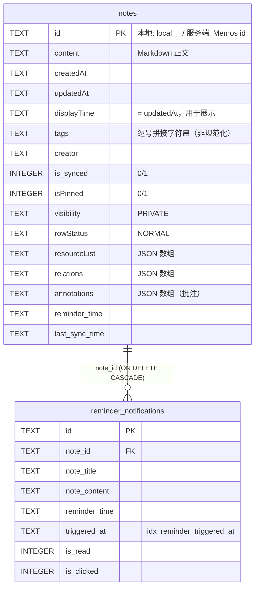

| 项 | 值 | 出处 |
|---|---|---|
| 库文件 | `notes.db` | `config/app_config.dart:231` |
| schema 版本 | **8** | `config/app_config.dart:234` |
| 移动端路径 | `getDatabasesPath()` | `database_service.dart:40` |
| 桌面端路径 | `getApplicationSupportDirectory()/databases`（Windows/Linux 用 FFI） | `database_service.dart:30-40,55-63` |
| 外键 | `PRAGMA foreign_keys = ON` | `database_service.dart:47` |
| **加密** | **无。** 无 SQLCipher、无 `PRAGMA key`；`notes.db` 是明文。加密只用于**导出的备份文件**（AES-256-CBC + HMAC-SHA256 + PBKDF2，`local_backup_restore_screen.dart:1203-1421`） | — |
| 索引 | 仅 2 个，都在 `reminder_notifications`；**`notes` 表一个索引都没有** | `database_service.dart:106-111` |

**迁移历史（手工 `if (oldVersion < N)` 链，`database_service.dart:115-183`）**

| 版本门 | 变更 |
|---|---|
| `< 1` | `notes` += `is_synced`、`isPinned`、`visibility` |
| `< 2` | `notes` += `resourceList` |
| `< 3` | `notes` += `relations` |
| `< 4` | `notes` += `reminder_time` |
| `< 7` | `notes` += `last_sync_time`（**该判断块写在 `< 5` 之前，顺序异常**） |
| `< 5` | 建 `reminder_notifications` + 2 个索引 |
| `< 6` | `notes` += `rowStatus` |
| `< 8` | `notes` += `annotations` |

### 6.2 其它存储

| 介质 | 存什么 | 备注 |
|---|---|---|
| `SharedPreferences` | AppConfig、User、偏好、功能开关、`last_sync_time`、`notion_field_mapping`、行为统计 | key 集中定义在 `config/app_config.dart:245-281` |
| `flutter_secure_storage` | `auth_token`、`refresh_token`、`server_url`、`username`、`password`、`ai_api_key`、`iflytek_*`、`webdav_password` | Android 用 `encryptedSharedPreferences: true`（`preferences_service.dart:22-30`） |
| 文件系统 | 图片、导出备份、导入文件 | — |
| 原生 `SharedPreferences: inkpaper_widget` | 桌面小组件 JSON 快照 | 由 `widget_snapshot_service.dart` 写入、Kotlin 读取 |

---

## 7. 同步与网络架构

### 7.1 三条并行同步链路

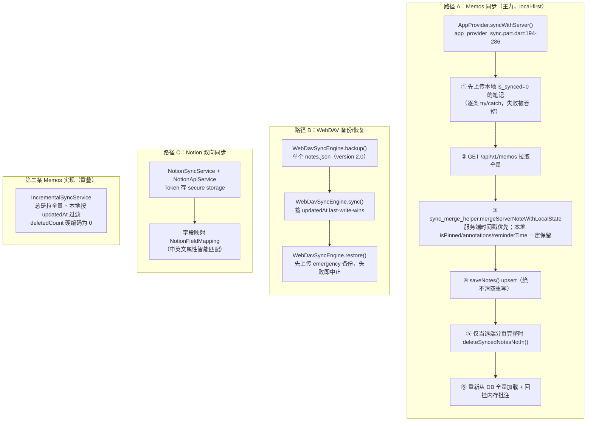

**同步语义总结**

| 维度 | 现状 |
|---|---|
| 冲突策略 | 按 `updatedAt` **last-write-wins**；`sync_merge_helper` 对本地 `isPinned` / `annotations` / `reminderTime` 做保护 |
| 离线队列 | **无**。失败的上传被逐条 `catch` 吞掉（`app_provider_sync.part.dart:214-216`） |
| 删除墓碑 | **无**。`IncrementalSyncService` 硬编码 `deletedCount = 0`（`:92,115-117`）；WebDAV 的 `SyncStats.deleted` 字段从未赋值 |
| 冲突记录 | **无**。`SyncStats.conflicts` 也从未赋值；无冲突 UI |
| 同步状态 | 只有 `notes.is_synced`(0/1)、`notes.last_sync_time`、内存态 `SyncStatus` 枚举 |
| Token 过期判定 | **中文字符串匹配**：`'Token无效或已过期'`（`sync_status_helper.dart:3-6`，用于 `app_provider.dart:2930` 与 part `:164`） |
| 重试/退避 | 只有 API 工厂层的固定 3 次重试；无指数退避、无队列 |
| 三套实现 | `app_provider_sync.part.dart`(287) + `IncrementalSyncService`(204) + `WebDavSyncEngine`(945)，各自重写合并逻辑，只有主路径复用 `sync_merge_helper` |

### 7.2 API 抽象层的真实形态

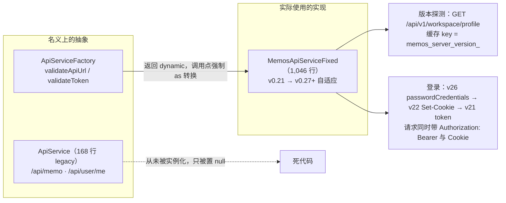

- **`ApiService` 接口化是假的**：`ApiServiceFactory.createApiService()` 返回 `dynamic`，调用点被迫 `as MemosApiServiceFixed` 强转（`app_provider.dart:1332,1765,1842,3712,3799,3818`）。
- **无 JWT 刷新流程**：`refresh_token` 存了但从不使用；401 → `TokenExpiredException` → 强制登出。
- **端点覆盖面**（部分）：`/api/v1/memos` CRUD、`/api/v1/memo/{id}/relation`、`/api/v1/memos/{id}/relations`、`/api/v1/attachments`、`/api/v1/resource/blob`、`/api/v1/workspace/profile`、`/api/v1/auth/{signin,me,status,signout}`、`/api/v1/users/{id}`。

---

## 8. Android 原生层与桥接

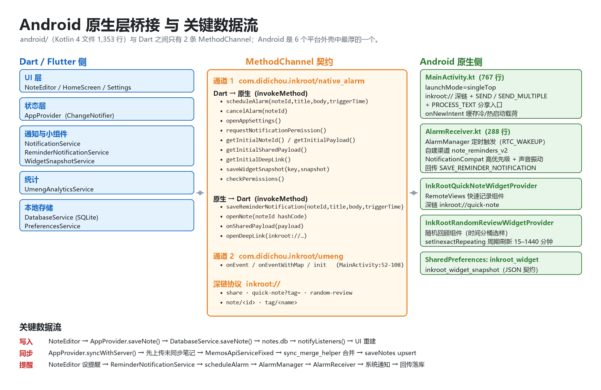

### 8.1 桥接契约（只有 2 条 MethodChannel，无 EventChannel）

| 通道 | 名称 | 用途 |
|---|---|---|
| 通道 1 | `com.didichou.inkpaper/native_alarm` | 提醒闹钟、小组件快照、冷启动载荷、权限检查 |
| 通道 2 | `com.didichou.inkpaper/umeng` | 友盟埋点（默认关闭） |

**Dart → 原生**（`MainActivity.kt:110-168`）

| 方法 | 参数 | 原生行为 |
|---|---|---|
| `scheduleAlarm` | noteId, title, body, triggerTime | AlarmManager：API≥31 仅在 `canScheduleExactAlarms()` 时用 `setExactAndAllowWhileIdle`，否则 `setAndAllowWhileIdle` |
| `cancelAlarm` | noteId | 取消 PendingIntent |
| `openAppSettings` | — | 跳应用详情设置 |
| `requestNotificationPermission` | — | 请求 POST_NOTIFICATIONS |
| `getInitialNoteId` / `getInitialPayload` | — | 返回冷启动缓存的 noteId |
| `getInitialSharedPayload` | — | 置 `flutterReadyForNativeEvents=true` 并回放分享载荷 |
| `getInitialDeepLink` | — | 返回冷启动深链 |
| `saveWidgetSnapshot` | key, snapshot | 写 SharedPreferences `inkpaper_widget` + 广播 `APPWIDGET_UPDATE` |
| `checkPermissions` | — | 返回通知/横幅/锁屏/闹钟/电池/自启动权限 Map |

**原生 → Dart**（`invokeMethod`）

| 方法 | 触发场景 | Dart 处理位置 |
|---|---|---|
| `saveReminderNotification` | 闹钟触发后回传落库 | `main.dart:205` |
| `openNote` | 点击提醒通知 | `main.dart:239` |
| `onSharedPayload` | 系统分享（文本/图片/文件） | `main.dart:283` |
| `openDeepLink` | `inkpaper://` 深链 | `main.dart:326` |
| `onSharedImage/Images/File` | 已废弃 | `main.dart:293-325`（**死分支**，原生不再发送） |

> ⚠️ **类型不匹配 bug**：`getInitialPayload` 原生返回 `Int`（`MainActivity.kt:140-143`），而 Dart 侧要求 `String`（`main.dart:339`），因此该冷启动路径实际失效，真正生效的是 `getInitialNoteId`。

### 8.2 Android 组件清单

| 类型 | 名称 | exported | 说明 |
|---|---|---|---|
| `<activity>` | `.MainActivity` | **true** | `singleTop`、`taskAffinity=""`、8 个 intent-filter：LAUNCHER、`inkpaper://` 深链、SEND `text/*`/`image/*`/`*/*`、SEND_MULTIPLE、PROCESS_TEXT |
| `<receiver>` | `.AlarmReceiver` | false | 无 intent-filter，只由显式 PendingIntent 触发 |
| `<receiver>` | `.InkPaperQuickNoteWidgetProvider` | **true** | 快速记录小组件，`updatePeriodMillis=0`（完全靠 Dart 推送刷新） |
| `<receiver>` | `.InkPaperRandomReviewWidgetProvider` | **true** | 随机回顾小组件，自带 `setInexactRepeating` 周期闹钟 + 30 分钟框架兜底 |
| `<service>` / `<provider>` | 无 | — | FileProvider 由 `image_picker_android` 等插件 AAR 提供 |
| `<queries>` | PROCESS_TEXT、http/https/mailto/tel | — | 刻意避免 `QUERY_ALL_PACKAGES` |

**权限**：`INTERNET`、`ACCESS_NETWORK_STATE`、`READ_EXTERNAL_STORAGE`(≤32)、`WRITE_EXTERNAL_STORAGE`(≤28)、`CAMERA`、`RECORD_AUDIO`、`WAKE_LOCK`、`VIBRATE`、`POST_NOTIFICATIONS`。
刻意**不申请**（并由 `tool/inkpaper.dart:128-142` 的 `store-check` 强制拦截）：`SCHEDULE_EXACT_ALARM`、`READ_MEDIA_IMAGES`、`requestLegacyExternalStorage`。

### 8.3 小组件与通知

| 机制 | 实现 |
|---|---|
| 小组件数据契约 | Dart 侧 `WidgetSnapshotService` 生成 `schemaVersion:1` JSON（`today{notes,words,tags,pendingTodos}`、`sync{...}`、`quickTags`、`reviewConfig`、`reviewNotes`），**350ms 防抖**、JSON 未变则跳过 |
| 小组件刷新 | Dart 推送快照 + 手动 `APPWIDGET_UPDATE` 广播；随机回顾组件另有自身 `AlarmManager` 周期闹钟 |
| 随机回顾选样 | **确定性时间分桶**：`index = (now / intervalMillis) % reviewCount`（`InkPaperWidgetProvider.kt:156-162`），不是真随机 |
| 深链协议 | `inkpaper://share`、`inkpaper://quick-note?tag=`、`inkpaper://random-review`、`inkpaper://note/{id}`、`inkpaper://tag/{name}` |
| 提醒通知 | `AlarmReceiver` 自建渠道 `note_reminders_v2`（IMPORTANCE_HIGH + 声音 + 振动 + 锁屏可见），`notify(noteId)`，点击回到 `MainActivity` |
| 通知落库 | 闹钟触发后**再发一个 Activity intent**（`SAVE_REMINDER_NOTIFICATION`）由 Dart 落库；**代价是提醒会把应用拉到前台**（`AlarmReceiver.kt:275`） |

---

## 9. 工程化：构建、测试与发布

### 9.1 项目 CLI `tool/inkpaper.dart`（608 行）

`doctor` · `deps` · `analyze` · `test [--coverage]` · `verify [--coverage]` · `store-check` · `build {android-debug|android-release|android-aab|ios-sim|ios-unsigned-ipa|macos-*|windows-*|linux-*}` · `run` · `release vX.Y.Z` · `clean` · `version`

其中 **`store-check`**（`:89-205`）是 Android/合规的"契约执行器"：校验 versionName/versionCode/applicationId/`android.app.Application`/`buildConfig`，**禁止**三个 manifest 项，校验 iOS 隐私清单、账号删除页、以及 release 工作流中的证书指纹与签名失败文案。

### 9.2 CI/CD 流水线

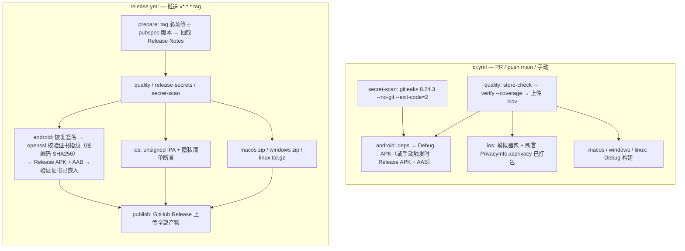

- 6 个平台产物：Android APK/AAB、iOS unsigned IPA、macOS zip、Windows zip、Linux tar.gz；**Web 不构建**。
- Dependabot 覆盖 `pub`、`github-actions`、`gradle(/android)` 三条生态。
- `analysis_options.yaml`：`flutter_lints` + 关闭隐式 cast/dynamic + 约 200 条规则，并对每条被禁用的规则写了理由。

### 9.3 Android 构建兼容性与实测编译记录

> 本节在 **2026-10-16 实测编译后更新**：仓库的 Gradle / AGP / Kotlin 版本已在工作区升级（**改动尚未提交**），Android 构建现在可以正常通过。

| 项 | 升级前 | 现在（工作区未提交） | Flutter 3.47.7 的下限 |
|---|---|---|---|
| Gradle wrapper | 8.12 | **8.14.3** | 错误下限 8.14.0 / 告警下限 9.1.0 |
| AGP | 8.9.1 | **8.11.1** | 错误下限 8.11.1 / 告警下限 9.0.1 |
| Kotlin (KGP) | 2.1.0 | **2.2.20** | 错误下限 2.2.20 / 告警下限 2.3.20 |
| Java 工具链 | `sourceCompatibility 11` | 不变 | Gradle 运行 JVM 必须 ≥ 17（本机 JDK 17 已满足） |

**结论**：构建**通过**，但会打印 3 条 "Flutter support … will soon be dropped" 告警，建议继续升到 Gradle 9.1.0 / AGP 9.0.1 / KGP 2.3.20。升级前的那组版本会抛 `DependencyValidationException` **硬失败**（当时的临时绕行参数是 `--android-skip-build-dependency-validation`）。

**实测编译记录（2026-10-16）**

| 项 | 值 |
|---|---|
| 命令 | `flutter build apk --debug`（**不带**绕行参数，已验证可通过） |
| 产物 | `build/app/outputs/flutter-apk/app-debug.apk` |
| 大小 / SHA-256 | 176.02 MB / `DE2FF513…91FD499F` |
| 包信息（`aapt dump badging`） | `com.didichou.inkpaper` · versionName `1.1.13` · versionCode `10113` · label `InkPaper` |
| ABI | arm64-v8a、armeabi-v7a、x86_64 |
| 签名 | Android Debug 证书（debug 包，不能用于上架） |
| 耗时 | 首次 ≈746 s（含从零下载 Gradle 发行包与全部 Maven 依赖，`.gradle` 缓存原本为空）；二次 ≈428 s |
| 体积说明 | 176 MB 属正常：debug 含 `assets/flutter_assets/kernel_blob.bin`（约 118 MB，JIT 模式）；release 包会显著更小 |

另有两个"配置读起来是 A、实际生效是 B"的陷阱（其中第 1 条已由 `aapt` 实测确认）：

1. `android/gradle.properties:8-10` 写着 `flutter.compileSdkVersion=34 / targetSdkVersion=34 / minSdkVersion=23`，但 Flutter 3.47.7 **不再读取**这三个属性。**实测产物为 compileSdk 36 / minSdk 24 / targetSdk 36**（`aapt`：`compileSdkVersion='36'`、`sdkVersion:'24'`、`targetSdkVersion:'36'`）。`android/build.gradle:2-6` 的 `ext{}` 同样是死配置（`app/build.gradle` 只用 `flutter.*`）。
2. `android/local.properties` 不入库（被 gitignore），而 `settings.gradle:4` 用 `withInputStream` 无条件读取 → 直接调 `gradlew` 会失败，必须由 `flutter build` / `flutter pub get` 先生成（本次已生成，含 `flutter.versionName=1.1.13` / `flutter.versionCode=10113`）。

---

## 10. 横切关注点

| 关注点 | 实现 | 备注 |
|---|---|---|
| 主题 | Material 3，`useMaterial3: true`，主色 `#2C9678`；`_ThemeCache` 缓存 `ThemeData`；字体走 `google_fonts` **运行时下载** | `themeMode='fenglan'`（凤蓝）是死路径：`getTheme` 只有 `default` 分支且无调用方 |
| 亮暗模式 | `themeSelection(system/light/dark)` → `AppProvider.isDarkMode` → `ThemeMode` | 切换靠 `MethodChannel`? 否——靠 `key: ValueKey('app_${themeSelection}_$locale')` **重建整棵树**，会丢页面状态 |
| 国际化 | **两套并行**：① 自研 `Translations`（1,246 键）+ `AppLocalizationsSimple` 门面（全项目主用）；② 生成式 ARB + `AppLocalizations`（仅 `share_image_preview_screen.dart` 使用） | 声明支持 zh/en；但 `models/app_config_model.dart:194-217` 留了 23 种语言的死分支 |
| 日志 | 实际用 `lib/utils/logger.dart`；`services/logger_service.dart`（307 行）是死代码 | 存在两套日志体系 |
| 错误监控 | Sentry **仅 Android** 初始化（iOS 为 App Store 合规而禁用）；`GlobalErrorCatcher` 装的 `FlutterError.onError` 随后被 `main.dart:95-122` 覆盖 | 脱敏 `beforeSend` 实际失效；两套 Sentry 配置并存 |
| 性能监控 | `PerformanceMonitorService` 被 `enablePerformanceLogging`（**恒 false**）挡住，默认不启用 | 看板页 `/performance-dashboard` 仍在 |
| 功能开关 | `FeatureFlagService` 在 `main.dart:133` 初始化，但**全项目没有任何代码读 flag** | 整套 feature flag 是摆设 |
| 权限 | 三套权限服务**全部为死代码**（`permission_manager`、`simple_permission_service`、`ios_permission_service`）；实际请求逻辑散在 `permission_dialog.dart` / `permission_guide_dialog.dart` | 重复实现 4 处权限弹窗 |
| 统计 | 友盟 U-App：Android 走 MethodChannel；`enableAnalytics = false` 使其默认关闭 | `enableUmengAnalytics` 恒 false |
| 测试 | 30 个单元测试 + 7 个 Widget 测试 + 1 个 integration test（6,277 行，约为 lib 代码量的 6%） | 覆盖模型、DB 迁移、Memos API、同步合并、标签、待办解析、Markdown 渲染 |

---

## 11. 架构评估

### 11.1 做得好的部分

1. **本地优先的数据策略是正确的**：写入先落 SQLite，云同步可失败可重试，离线可用；`saveNotes` 用 upsert 且**绝不清空重写**，`deleteSyncedNotesNotIn` 只在远端分页完整时才剪枝（避免误删）。
2. **分层边界总体清晰**：`services` 隔离 IO 与第三方，`models` 无 UI 依赖，`utils` 无状态化，`main.dart` 装配关系一目了然。
3. **合规与工程化程度高**：`store-check` 把商店/签名/权限约束固化成 CI 门禁；release 流程校验签名证书指纹与嵌入结果；gitleaks 扫描；隐私清单断言。
4. **多后端抽象有实用价值**：同一个 `MemosApiServiceFixed` 兼容 v0.21 → v0.27+ 四种 API 世代，自托管用户覆盖面明显更广。
5. **平台能力收敛得当**：Android 只用 2 条 MethodChannel、1,353 行 Kotlin 就实现了定时提醒 + 双桌面小组件 + 深链 + 8 类系统分享入口。

### 11.2 风险清单（按优先级）

| 级别 | 风险 | 证据 | 影响 |
|---|---|---|---|
| **P0** | `notes.db` **明文无加密**，而隐私政策文案声称安全存储 | `database_service.dart`（无 SQLCipher）；`legal_document_screen.dart:291` | 隐私合规 / 数据泄露 |
| ~~P0~~ **已修复** | ~~**Android 构建在当前 Flutter SDK 下硬失败**~~ | 原：Gradle 8.12 / AGP 8.9.1 / KGP 2.1.0 低于 Flutter 3.47.7 下限 | 已在工作区升级为 8.14.3 / 8.11.1 / 2.2.20（**未提交**），2026-10-16 实测出包成功；仅剩 3 条待消除的告警（见 [§9.3](#93-android-构建兼容性与实测编译记录)） |
| **P1** | `AppProvider` 上帝对象：4,613 行 / 131 方法，根级 `Consumer` 包住整个 `MaterialApp.router` | `app_provider.dart:56`；`main.dart:619-761`；64 处 `notifyListeners` | 任一状态变更全树重建；可维护性与性能 |
| **P1** | **同步语义不完整**：无删除墓碑、无冲突记录、无离线队列、失败上传被吞 | `incremental_sync_service.dart:92,115-117`；`app_provider_sync.part.dart:214-216`；`SyncStats.deleted/conflicts` 从未赋值 | 多端使用会静默丢数据 |
| **P1** | 本地/服务端 ID 判定用 `id.contains('-')`，UUID 形式的服务端 id 会被当成"本地未同步"而**静默跳过更新与删除** | `memos_api_service_fixed.dart:596,656,813` | 同步静默失效 |
| **P1** | `AppProvider.initializeApp()` 在 HomeScreen 首帧后才跑，深链直达其他页面时 provider 未初始化 | `home_screen.dart:82,423-455` | 冷启动竞态 |
| **P2** | `notes` 表**无任何索引**，却按 `createdAt DESC`、`is_synced=0`、`tags LIKE` 查询并全量载入内存 | `database_service.dart:218-237,271-275,361-370` | 大库性能 |
| **P2** | 标签存成逗号拼接字符串 + `LIKE '%tag%'` 过滤 → 前缀相同标签误匹配 | `note_model.dart:82-84`；`database_service.dart:361-370` | 搜索/筛选错误 |
| **P2** | Token 过期用**中文字符串匹配**判定 | `sync_status_helper.dart:3-6` | 服务端改文案即失效 |
| **P2** | 版本缓存 key 用 `String.hashCode` | `memos_api_service_fixed.dart:52,87,177,190` | Dart 字符串 hash 不保证跨运行稳定 |
| **P2** | `GlobalErrorCatcher` 的错误上报被覆盖，脱敏逻辑失效 | `main.dart:45` vs `:95-122` | 崩溃上报缺失隐私脱敏 |
| **P2** | 三套同步实现、两套 i18n、两套日志、两套 Markdown 渲染、三套权限服务 | 见 §12.3 | 维护成本翻倍 |
| **P2** | `getInitialPayload` 原生返 `Int` 而 Dart 期望 `String` | `MainActivity.kt:140-143`；`main.dart:339` | 冷启动通知跳转失效 |
| **P3** | 死配置：`canaryStages/canaryPercentage`、`isFeatureEnabled`、`appUpdateUrl`、`enableAutoUpdate`、`setThemeMode` | `config/app_config.dart:220-226,520,573`；`main.dart:72` | 认知负担 |
| **P3** | 平台判定三套标准不一致：桌面 = macOS\|Windows、视觉缩放 = +Linux、DB FFI = Windows\|Linux | `app_router.dart:350`；`main.dart:767-768`；`database_service.dart:30,38` | Linux 行为混合 |
| **P3** | 文档与实现漂移（见 §12.4） | — | 误导维护者 |

### 11.3 死代码与重复实现清单

| 类别 | 内容 | 规模 |
|---|---|---|
| 死服务（10） | `api_service`(168)、`alert_service`(239)、`announcement_service`(178)、`ios_permission_service`(169)、`ios_update_service`(237)、`logger_service`(307)、`permission_manager`(388)、`simple_permission_service`(291)、`tag_ai_service`(706)、`ai_related_notes_service`(728) | **约 3,411 行** |
| 死 Widget（7） | `related_notes_bottom_sheet`(425)、`tag_color_picker`(437)、`user_agreement_screen`(366)、`privacy_policy_dialog`(176)、`permission_dialog`(182)、`interactive_markdown`(163)、`progress_overlay`(62) | **约 1,811 行** |
| 死配置/开关 | feature flag 全套、灰度发布、`themeMode='fenglan'`、`appUpdateUrl` | — |
| 重复实现 | 3 套同步 · 2 套 i18n · 2 套日志 · 2 套 Markdown 渲染 · 4 处权限弹窗 · 3 套"相关笔记" · 2 个主题排版文件（`themes/typography.dart` 与 `themes/app_typography.dart` 各 311 行、同名同类、逐行重复且均未被引用） | — |

### 11.4 建议的改进顺序

**短期（低风险、高收益）**
1. **（已部分完成）** Gradle/AGP/Kotlin 已在工作区升到 Flutter 3.47.7 的**错误下限**（8.14.3 / 8.11.1 / 2.2.20），构建可通过但仍打印 3 条告警——建议继续升到 Gradle 9.1.0 / AGP 9.0.1 / KGP 2.3.20 彻底消除，否则下个 Flutter 版本会再次硬失败。同时删除 `gradle.properties` 与 `android/build.gradle` 中失效的 SDK 版本声明（实测产物为 compileSdk 36 / minSdk 24 / targetSdk 36），避免误导。
2. 给 `notes` 表补索引：`createdAt`、`is_synced`、并把标签规范化（`note_tags` 关联表）以替换 `LIKE` 匹配。
3. 修正 `getInitialPayload` 的 Int/String 类型不匹配；删除 Dart 侧 `onSharedImage/Images/File` 死分支与重复路由注册（`/notifications`、`/account-deletion`）。
4. 清理死代码：先删零引用的服务与 Widget（约 5,200 行），并把 `AppConfig` 的两个同名类改名消除歧义。

**中期（结构性）**
5. 拆分 `AppProvider`：按领域切成 `NoteStore` / `SyncStore` / `AuthStore` / `UiPrefsStore`，用 `MultiProvider` + `Selector` 替换根级 `Consumer`，消除"任一变更全树重建"。
6. 补同步语义：引入 tombstone（删除标记）、冲突记录表与失败重试队列；把三套同步实现收敛为一套 `SyncEngine` 接口 + 3 个后端适配器。
7. 修 `id.contains('-')` 判定，改用显式的 `localId` 标记位或 `origin` 字段。
8. 数据库加密（SQLCipher 或应用层字段加密），使隐私声明与实现一致；同时把 `AppProvider.initializeApp()` 提到 `runApp` 之前或做幂等守卫，解决深链竞态。
9. i18n 二选一（建议保留 ARB 生成式），日志二选一，把 `GlobalErrorCatcher` 与 `main.dart` 的错误处理合并为一条链路。

**长期（架构演进）**
10. 把 `lib/services/note_actions_service.dart`（1,698 行、反向依赖 UI）拆成领域用例，恢复 services 不依赖 screens 的分层约束。
11. 为同步/数据库/模型补测试（当前测试约为 lib 代码量的 6%，且同步合并、冲突、迁移的边界用例不足）。

---

## 12. 与现有文档的差异（文档已过期，建议同步）

`docs/architecture/README.md` 与实际代码的偏差：

| 项目 | 文档说法 | 实际 |
|---|---|---|
| Screens | 26 个文件 | **34** 个 |
| Widgets | 19 个文件 | **27** 个 |
| Services | 35 个 | **54** 个 |
| 分层图 | 4 层（无平台层/外部依赖/工具层） | 6 层 |
| 数据表 | 列了 6 张表（notes/tags/note_tags/resources/reminders/sync_status） | **只有 2 张**（notes、reminder_notifications） |
| 名称 | InkPaper | 小纸 / InkPaper（InkPaper 为历史名） |

`docs/PROJECT_STRUCTURE_AND_BUILD.md` 的偏差：

| 项目 | 文档说法 | 实际 |
|---|---|---|
| Android 源码清单 | 只列 `MainActivity.kt`、`AlarmReceiver.kt`、`ReleaseLog.kt` | 漏了 `InkPaperWidgetProvider.kt`（含两个小组件 Provider）与两个 widget receiver |
| iOS 目标 | 只提 Runner | 还有 `InkPaperWidgets`、`InkPaperShareExtension`、vendored `SDWebImageWebPCoder` |
| clone 地址 | `yyyyymmmmm/InkPaper.git` | 仓库实际是 `liudengxing/InkPaper`（`README.md:5`） |
| SDK 版本 | 暗示 34/21 | 实际生效 36/24/36 |
| 引用的文档 | `database-schema.md`、`security-design.md`、`performance.md`、`../TESTING.md` | **这些文件不存在**（`docs/architecture/` 下只有 `README.md` 与 `adr/`） |
| ADR 列表 | 文档列出 002–005 | `docs/architecture/adr/` 下**只有 001 与 template** |

---

## 附录 A：路由全表

| 路径 | name | 页面 |
|---|---|---|
| `/privacy-policy` | privacy-policy | `PrivacyPolicyScreen` |
| `/privacy-policy-detail` | privacyPolicyDetail | `LegalDocumentScreen(privacy)` |
| `/user-agreement` | userAgreement | `LegalDocumentScreen(agreement)` |
| `/legal-documents` | legalDocuments | `LegalDocumentsHubScreen` |
| `/account-deletion` | accountDeletion / homeAccountDeletion | `AccountDeletionScreen`（**重复注册**） |
| `/onboarding`、`/welcome` | onboarding / welcome | `OnboardingScreen`（**同页两入口**，逻辑已注释） |
| `/` | home | `DesktopLayout(HomeScreen)` |
| `/note/:id`、`/note/:id/edit` | noteDetail / noteEdit | `NoteDetailScreen`（**同页**） |
| `/random-review` | randomReview | `DesktopLayout(RandomReviewScreen)` |
| `/tags`、`/tags/detail?tag=` | tags / tag-notes | `TagsScreen`、`TagNotesScreen` |
| `/knowledge-graph` | knowledgeGraph | `DesktopLayout(KnowledgeGraphScreenCustom)` |
| `/help`、`/settings/help` | help / settingsHelp | `HelpScreen` |
| `/settings` | settings | `SettingsScreen`（内嵌 13 子页） |
| `/settings/about` | settingsAbout | `AboutScreen` |
| `/settings/import-export` | importExport | `ImportExportMainScreen` |
| `/settings/local-backup-restore` | localBackupRestore | `LocalBackupRestoreScreen` |
| `/settings/flomo-import` | flomoImport | `FlomoImportScreen` |
| `/settings/weread-import` | wereadImport | `WeReadImportScreen` |
| `/settings/notion-settings` | notionSettings | `NotionSettingsScreen` |
| `/account-info` | accountInfo | `AccountInfoScreen` |
| `/server-info` | serverInfo | `ServerInfoScreen` |
| `/data-cleanup` | dataCleanup | `DataCleanupScreen` |
| `/preferences`、`/preferences/sidebar-customization` | preferences / sidebarCustomization | `PreferencesScreen`、`SidebarCustomizationScreen` |
| `/ai-settings` | aiSettings | `AiSettingsScreen` |
| `/user-preferences` | userPreferences | `UserPreferencesScreen` |
| `/webdav-settings` | webdavSettings | `WebDavSettingsScreen` |
| `/login`、`/register`、`/forgot-password` | login / register / forgotPassword | `LoginScreen`、`RegisterScreen`、`ForgotPasswordScreen` |
| `/notifications` | notifications / notificationsPage | `NotificationsScreen`（**重复注册**） |
| `/feedback` | feedback | `FeedbackScreen` |
| `/laboratory` | laboratory | `LaboratoryScreen`（占位） |
| `/performance-dashboard` | performanceDashboard | `PerformanceDashboardScreen` |

---

## 附录 B：分析方法与证据来源

| 结论类型 | 方法 |
|---|---|
| 代码规模 | 按目录统计 `lib/`、`test/`、`android/` 各文件行数（lib 102,042 行 + 测试 6,277 行 = 108,319 行 Dart；行数含空行，与 `read` 工具报告的总行数一致） |
| 服务依赖边 | 解析每个 `lib/services/*.dart` 的 `package:inkpaper/...` import，提取真实拓扑（非推测） |
| 数据库结构 | 直读 `database_service.dart` 的 `CREATE TABLE` / `CREATE INDEX` / `upgradeSchema` |
| 路由 | 直读 `app_router.dart` 全部 `GoRoute` 并以 `path/name/pageBuilder` 三元组核对 |
| Android 桥接 | 直读 `MainActivity.kt` 的 `setMethodCallHandler`/`invokeMethod` 与 Dart 侧 `MethodChannel` 调用点交叉验证 |
| 构建配置 | 直读 `app/build.gradle`、`settings.gradle`、`gradle.properties`、`gradle-wrapper.properties` |
| CI/CD | 逐 job 读取 `.github/workflows/{ci,release}.yml` |
| 死代码判定 | 对类名做全库引用检索（`lib/` 全域），零引用方判定为死代码 |
| 环境兼容性 | 读取本机 Flutter SDK（`Z:\flutter` 3.47.7）的版本检查器与 `FlutterExtension` 实现 |

> 本报告的图片由 `docs/architecture/images/` 下的 PNG 提供；Mermaid 代码块可在 GitHub、VS Code、Typora 等支持 Mermaid 的渲染器中直接显示。
